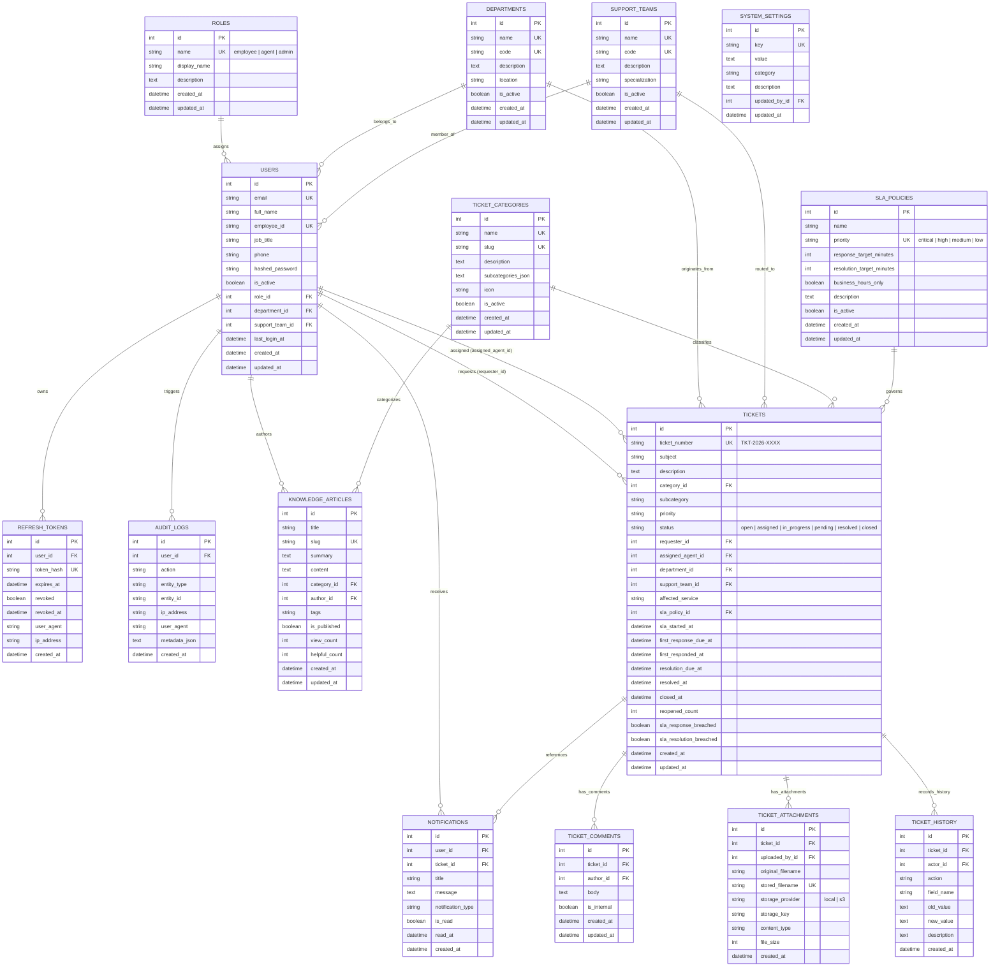

# TicketDesk Enterprise — Database Schema & ER Diagram

## 1. Entity-Relationship (ER) Diagram

## 2. Indexes & Constraints Summary

- **Composite Indexes on `tickets`**:
  - `ix_tickets_status_priority (status, priority)`
  - `ix_tickets_requester_status (requester_id, status)`
  - `ix_tickets_agent_status (assigned_agent_id, status)`
- **Unique Constraints**:
  - `tickets.ticket_number` (`TKT-2026-XXXX`)
  - `users.email`, `users.employee_id`
  - `roles.name`, `departments.code`, `support_teams.code`, `sla_policies.priority`
  - `refresh_tokens.token_hash`
- **Migrations**: Managed via Alembic (`backend/migrations/versions/0001_initial_schema.py`).
